# Ruta del Cóndor — Reporte técnico (Unidad 3)
**Autores:** Diego Reyes Natilla · José Heriberto Osorio · **Nube:** AWS (us-east-1) · **Fecha:** 16/11/2026

## 1. Resumen
*Ruta del Cóndor* es una carrera aérea multijugador en 3D (hasta 8 aviones por partida) con bots, mejoras que duran toda la partida, clima dinámico y tabla de líderes global. Se desplegó en AWS con contenedores, Kubernetes + Agones, serverless e infraestructura como código, y se validó con pruebas de carga que simulan jugadores y espectadores.

## 2. Arquitectura
```
Jugadores ──WebSocket──► Servidores de partida (EKS + Agones, FleetAutoscaler)
                                │ métricas            ▲ Cluster Autoscaler (nodos)
                                ▼
                        Prometheus + Grafana
Fin de partida ──HTTP──► Lambda ──► DynamoDB (tabla de líderes)
Espectadores ──HLS────► S3 / CDN (stream de prueba)
Infraestructura: Terraform · Despliegue: GitHub Actions → Amazon ECR
```
| Componente | Servicio AWS |
|---|---|
| Servidor de partida | EKS 1.31 + Agones (nodos `t3.large`, 2–20) |
| Imágenes | Amazon ECR (`condor-server`) |
| Tabla de líderes | Lambda (Python 3.12) + DynamoDB |
| Streaming (prueba) | S3 privado + CloudFront (OAC) |
| Observabilidad | Prometheus + Grafana (kube-prometheus-stack) |
| IaC | Terraform (VPC, EKS, ECR, Agones, Lambda, DynamoDB, Cluster Autoscaler) |

## 3. Cómputo para IA (práctica 3.1)
Entrenamiento: bot PPO en CartPole (sustituto didáctico).
| | CPU | GPU (T4) |
|---|---|---|
| Entrenamiento 100 000 pasos | **138,0 s** | 217,6 s |
| Latencia de inferencia | **0,416 ms** | 0,732 ms |
| Decisiones/s por núcleo | **2 406** | 1 367 |
| vCPU para 2 000 bots a 10 Hz (20 000 inf/s, +30 % margen) | **11** | 20 |
| Costo de inferencia | **USD 0,47/h** | USD 0,85/h |
La CPU entrenó 1,6 veces más rápido y sirvió 1,8 veces más decisiones por núcleo.
*Conclusión:* con una red tan pequeña la GPU no gana por el costo de copiar datos; la inferencia va en CPU y la GPU se reserva para entrenar con Spot y checkpoints.

## 4. Contenedores y orquestación (práctica 3.3)
El servidor (Python, WebSocket, 20 ticks/s) se empaqueta en una imagen y corre como `GameServer` de Agones (estados `Ready → Allocated → Shutdown`). La flota mantiene servidores libres y el SDK de Agones recibe `/ready`, `/health` cada 2 s y `/shutdown` al terminar. Evidencia: `evidencias/3.3_*.png` (3 servidores `Ready`, uno pasa a `Allocated` al pedir partida). **Prueba de juego en la nube:** el cliente web (local) se conectó por WebSocket al servidor `Allocated` de EKS (`ec2-32-197-192-200…:7456`), con 4 pilotos en sala y latencia de 325 ms desde el cliente local; ver `evidencias/3.4_jugando_en_la_nube.png` y `3.4_servidor_allocated.png`.
*¿Qué pasa si se borra un pod `Allocated`?* La partida en curso se pierde (los jugadores se desconectan) y la flota crea un servidor nuevo `Ready` para reponerlo; por eso Agones marca los pods asignados como no desalojables ante el autoescalado de nodos.

## 5. CI/CD (práctica 3.2)
`push` a `main` (cuando cambia `server/` o el pipeline) → pruebas (`pytest`) → construcción de la imagen → publicación en ECR con la etiqueta del commit → **actualización de la flota de Agones** (`kubectl patch` de la imagen; Agones reemplaza los servidores libres y deja terminar las partidas en curso). Comprobado: la flota corre la imagen `condor-server:2ef4e12…`, el commit del pipeline #8 (`evidencias/3.2_pipeline_actualiza_flota.png`). Evidencia: `evidencias/3.2_pipeline_verde.png` y `3.2_imagen_publicada_con_etiqueta_del_commit.png`.
*Rollback:* cada versión es una imagen inmutable con la etiqueta del commit; volver atrás es apuntar `k8s/fleet.yaml` a la etiqueta anterior y aplicar; Agones reemplaza solo los servidores libres y deja terminar las partidas en curso (drenado).

## 6. Autoescalado, métricas y pruebas de carga (práctica 3.4)
Tres capas: **partidas** (FleetAutoscaler), **servicios** (HPA del allocator, `k8s/hpa.yaml`; con `metrics-server` instalado por Terraform: mide la CPU del allocator, `cpu: 2%/40%`) y **nodos** (Cluster Autoscaler, `t3.large`, 2 a 20). Métricas en Prometheus + Grafana (`evidencias/3.4_*`): CCU, tick p99 (meta < 25 ms), servidores por estado, nodos, CPU y mensajes rechazados.
Los jugadores simulados corren como 4 pods de Locust dentro del clúster (misma región): cada bot manda su posición 20 veces por segundo y mide el RTT con un ping por segundo. Escenarios: **rampa** (200 jugadores a 2/s, 8 min) y **pico** (200 en ~20 s, 4 min). Las corridas 1 y 2 fueron de 200 jugadores (durante las pruebas la cuota de la cuenta era de 16 vCPU; el aumento a 96 se aprobó el 13/11, después de esas corridas); las corridas 3 (300) y 4 (600) se hicieron ya con la cuota de 96.
| Resultado | Valor |
|---|---|
| Jugadores simultáneos sostenidos | **200** (27 servidores `Allocated`, 8 nodos) |
| Jugadores por nodo | **≈ 25** con CPU de nodos entre 35 y 50 % |
| Tick del servidor p99 (Prometheus) | **≤ 7,5 ms** (meta 25 ms); 0 mensajes rechazados |
| Tiempo de reacción: servidores | **≈ 30–60 s** (de `Starting` a `Ready`) |
| Tiempo de reacción: nodos | **≈ 2 min** (de 4 a 8 nodos entre 22:12 y 22:14) |
| Errores en la rampa / en el pico | **0,43 % / 1,44 %** (resets de conexión y asignaciones 429) |
| Rechazos del allocator (429) | 5 de 33 asignaciones, en la rampa y en el pico |
Gráficas: tablero de Grafana de la corrida 2 (CCU, tick p99, servidores por estado y nodos 4 → 8) y las de Locust (`evidencias/3.4_grafica_rampa.png`, `3.4_grafica_pico.png`).

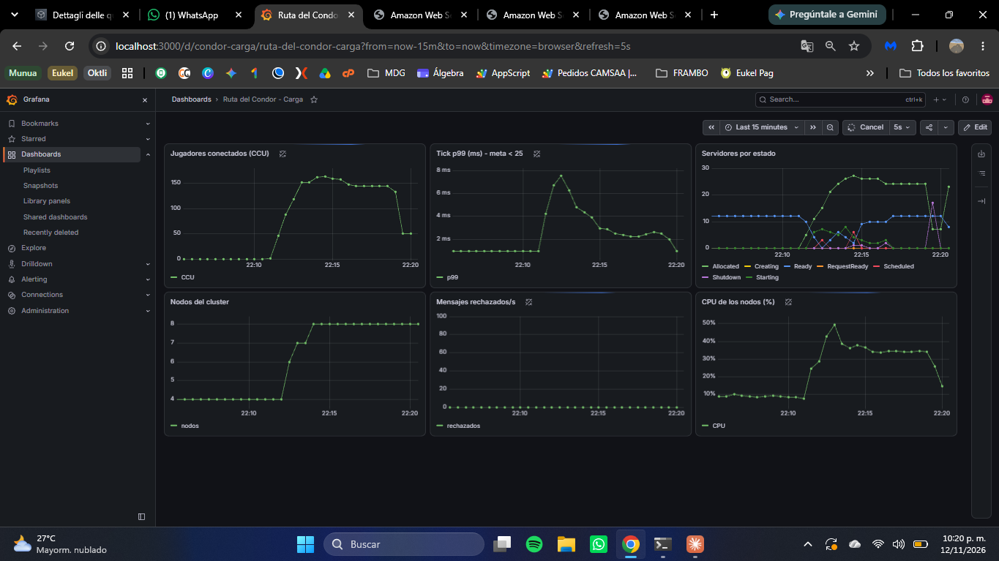

**Corrida 3: versión reducida de 300 jugadores (4 pods × 75), con la cuota ya en 96 vCPU.** Los nodos pasaron de **3 a 11** durante la prueba (Cluster Autoscaler) y el pico simultáneo medido fue de **~208 en la rampa y ~225 en el pico** (no se llegó a los 300 planeados). Errores: **0,68 % en la rampa y 6,08 % en el pico**, con 7 y 10 asignaciones rechazadas (429) y RTT p95 de 0,4 a 7 s según el pod (generadores compitiendo por CPU). El **HPA** del allocator midió `cpu: 2%/40%` y se mantuvo en 1 réplica: el allocator no se acercó al umbral, así que no escaló; queda demostrado que mide, no que escale bajo presión. Evidencias: `evidencias/3.4_corrida3_nodos_11_hpa.png`, `rampa_corrida3.png`, `pico_corrida3.png`. Conclusión: con un solo allocator y generadores en los mismos nodos, el sistema sostiene ~200–225 jugadores con pocos errores y degrada la latencia y las asignaciones al acercarse a 300; el siguiente paso sería más réplicas del allocator y generadores en nodos aparte.

**Corrida 4: 600 jugadores (8 pods × 75; buffer fijo de 25 servidores libres; tope de 30 nodos; cuota de 96 vCPU).** Es la prueba más grande: **600 jugadores** en Locust (~550 conectados en el tablero de Grafana) y 3 → **30 nodos** (el tope fijado) en ~12 min. Errores: **1,27 % en la rampa y 3,01 % en el pico**; el allocator rechazó con 429 el 67 % y el 60 % de los pedidos (165 de 245 y 118 de 198), que los jugadores reintentan cada 2 s hasta obtener servidor. RTT mediana de 36 a 130 ms por pod, p95 de 0,1 a 1,9 s. Tick del servidor p99 **≤ 6 ms** (meta 25 ms) y 0 mensajes rechazados. El **HPA** marcó `cpu: 6%/40%` y no escaló (el cuello fue el stock de servidores libres, no la CPU del allocator). Evidencias: `evidencias/3.4_corrida4_*.png`, `rampa_corrida4.png`, `pico_corrida4.png`. **No se llegó a los 1 000 jugadores del integrador:** las dos subredes `/24` (~500 IPs de pods) y la cuota de 96 vCPU limitan a ~30–40 nodos. Con 600 jugadores se confirma la versión reducida pedida por el manual (300) y se documenta dónde está el próximo límite.

**Hallazgos.**
1. **`bufferSize` de 20 % no alcanza para un pico.** En la primera corrida solo se conectaron ~52 jugadores: con pocos servidores asignados el 20 % deja 1 o 2 libres y el allocator respondía `429`. Con un buffer fijo de **12 servidores libres** la flota creció a 27 asignados y el CCU llegó a 200.
2. **El techo fue la cuota de vCPU.** Los nodos se detuvieron en 8 (= 16 vCPU). El autoescalador respondió bien; el límite lo puso la cuenta (ya aprobada a 96 vCPU, lo que permitiría unos 1 000 jugadores).
3. **La latencia medida por los clientes es poco confiable** (RTT mediana de 31 a 120 ms en la rampa, p95 de 230 ms a 2,1 s según el pod): los pods generadores compiten por CPU con los servidores. La medida del servidor (tick p99) no tiene ese sesgo. Mejora: generadores en nodos aparte.
4. Un primer intento con un solo pod de Locust de 1 CPU falló (el generador perdió sus procesos por falta de CPU), por eso se repartió en 4 pods.
**Espectadores (HLS a 360p, 800 kbps).** Video de prueba de 5 min en un bucket de S3 **privado** servido por **CloudFront** (Terraform: `infra/stream.tf`); 200 espectadores simulados (pod de Locust, un segmento de 2 s cada 2 s) durante 5 min.
| Resultado | Valor |
|---|---|
| Peticiones (manifiesto + segmentos) | 59 093, **0 fallas** |
| Latencia por segmento (mediana / p95 / p99) | **23 / 60 / 880 ms** (el reproductor aguanta hasta 2 000 ms sin cortes) |
| Máximo | 2,1 s, un solo segmento aislado |
| Datos transferidos | 6,4 GB en 5 min ≈ **77 GB/hora** (la fórmula da 72) |
*Extrapolación de espectadores:* GB/hora = CCV × kbps × 3 600 / (8 × 10⁶). Con 20 000 espectadores a 6 000 kbps: **54 000 GB ≈ 54 TB por hora**; a precios de lista de CloudFront (≈ 0,085 USD/GB en los primeros 10 TB, con descuento por volumen) serían **≈ USD 4 300 por hora**. Por eso el video se sirve desde una CDN con varias calidades (ABR) y la capa de juego no lo toca: el servicio de partidas pasa de ~25 jugadores por nodo a costar centavos, mientras el *streaming* domina el costo. Limitación: el generador superó el 90 % de CPU, así que las latencias pueden ser algo pesimistas. Gráfica: `evidencias/3.4_grafica_espectadores.png`.

## 7. Serverless (práctica 3.5)
Tabla de líderes con Lambda (Python 3.12) + DynamoDB, expuesta con una URL de función: guarda puntajes (POST) y devuelve el top 10 (GET). Probada con `curl` (`evidencias/3.5_tabla_lideres_funciona.png`).
**Prueba de carga:** 500 usuarios (80 % lecturas / 20 % escrituras), rampa de 25 usuarios/s durante 4 min, desde un pod de Locust en el clúster (`loadtest/locust_tabla.py`, resultados en `loadtest/tabla/`).
| Resultado | Valor |
|---|---|
| Peticiones totales | 111 221 (≈ 465 por segundo) |
| Respondidas correctamente (mediana / p95 / p99) | **15 ms / 100 ms / 130 ms** |
| Rechazadas con `429 Too Many Requests` | **82 %** (91 646) |
| Duración dentro de Lambda (CloudWatch) | mínima 6 ms · media 75 ms · **máxima 609 ms** (arranque en frío) |
| Concurrencia alcanzada / throttles | **tope plano en 10** / hasta **24 262 por minuto** |
| Primeros segundos (arranque en frío) | p95 ≈ 1 000 ms mientras Lambda crea los primeros entornos |
**Hallazgo:** la función respondió muy rápido cuando atendió, pero la cuenta tiene un tope de **10 ejecuciones simultáneas** (`aws lambda get-account-settings`; capturas `evidencias/3.5_lambda_*.png`), así que Lambda rechazó lo que excedía. Serverless escala solo, pero dentro de las cuotas de la cuenta: hay que pedir el aumento (a 1 000) antes de un evento real. Mejoras de diseño: guardar el top 10 en caché (por ejemplo 5 s) para que las lecturas no lleguen a la función, y cambiar el `scan` de DynamoDB por un índice.
*Costo:* 5 M consultas al mes de 50 ms y 256 MB = 62 500 GB-s, dentro de la capa gratuita de cómputo (400 000 GB-s); solo se cobran 4 M de peticiones por encima del millón gratis: **≈ USD 0,80 al mes**. Una VM `t3.medium` encendida todo el mes cuesta **≈ USD 30** (0,0416 × 730 h) y habría que dimensionarla, parchearla y escalarla a mano.

## 8. Infraestructura como código (práctica 3.6)
Todo vive en `infra/` (VPC, EKS, ECR, Agones, Lambda, DynamoDB, Cluster Autoscaler, S3 + CloudFront) y se crea con `terraform apply` en ~20 min y se borra con `terraform destroy`.
**Flujo de cambios con revisión:** los cambios de infraestructura se proponen en un *pull request* con el `terraform plan` en la descripción. Ejemplo: PR #1 (`evidencias/3.6_pull_request_plan.png`) cambia el tiempo en que el autoescalador baja nodos sin uso de 5 a 3 min; el plan muestra **0 para crear, 1 para cambiar, 0 para destruir** y se revisa antes de aplicar. Plan del autoescalador original: `evidencias/3.6_terraform_plan_autoescalador.png`.
**Evidencia de `apply` y de `destroy`:** `evidencias/3.6_terraform_apply_completo.png` y `evidencias/3.6_terraform_destroy_completo.png` (**`Destroy complete! Resources: 39 destroyed.`**). Después se auditó la cuenta (EKS, EC2, NAT, IP elásticas, discos, balanceadores, VPC, ECR, Lambda, DynamoDB, CloudFront, logs): no quedó ningún recurso cobrando; solo se conserva a propósito el bucket S3 del estado remoto de Terraform. **Lección del destroy:** el balanceador y su *security group* los crea Kubernetes (Servicio `LoadBalancer` del allocator), no Terraform, y bloquean la red; además el token de `aws login` (~15 min) se venció a mitad del borrado. Se resolvió borrando a mano esos dos recursos y usando credenciales que se renuevan solas (`credential_process`). En un entorno real conviene borrar los Servicios `LoadBalancer` antes del `terraform destroy`.
**Lecciones aprendidas:** (1) las credenciales temporales de AWS vencen durante el `apply` y Terraform retoma donde quedó; (2) un recambio de nodos se trabó porque Agones protege los servidores de juego con una regla de no desalojo: hubo que vaciar la flota; (3) el autoescalador debe ser de la misma versión que Kubernetes (1.31); (4) un bucket público fue rechazado por la protección de la cuenta, por eso el video se sirve con CloudFront y bucket privado. Mejora pendiente: estado remoto en S3 con bloqueo.

## 9. Costos (estimados, us-east-1; confirmar en la calculadora de AWS)
| Concepto | USD/h |
|---|---|
| Plano de control EKS | 0,10 |
| Nodos en reposo (2 × `t3.large`, 0,0832) | 0,17 |
| Nodos en pico (8 × `t3.large`) | 0,67 |
| Balanceador (allocator) y otros | ≈ 0,03 |
| **Total en reposo / en pico** | **≈ 0,30 / ≈ 0,80** |
**Costo por jugador/hora en pico** ≈ 0,80 ÷ 200 = **USD 0,004** (≈ 25 jugadores por nodo). Con el escalado a la baja (nodos fuera de pico) el costo medio baja hacia el de reposo.

## 10. Recomendaciones
- **`bufferSize`: 12 servidores fijos** (no 20 %) y `minReplicas` igual al buffer; subir proporcionalmente si se esperan picos más rápidos que 30–60 s (lo que tarda un servidor en estar listo).
- **Nodos:** `t3.large`, mínimo 2 y máximo 20; ≈ 25 jugadores por nodo. Pedir la cuota de vCPU antes de cualquier evento grande.
- **Regiones:** una (us-east-1) para el prototipo; para jugadores lejanos, una flota por región con matchmaking por latencia.
- **Medición:** generadores de carga en nodos separados para que la latencia no se contamine.

## 11. Seguridad y limitaciones
Auditoría completa en `AUDITORIA.md`: se corrigieron XSS por nombres, datos de red sin validar y un servidor sin límites (tamaño, ritmo, campos permitidos). Riesgos abiertos: el cliente decide puntos y daños (posible trampa), bots locales por navegador y sin TLS (`wss`) en el servidor.

## 12. Anexo: evidencias
<div style="display:flex;flex-wrap:wrap;gap:6px">
<figure style="width:32%;margin:0">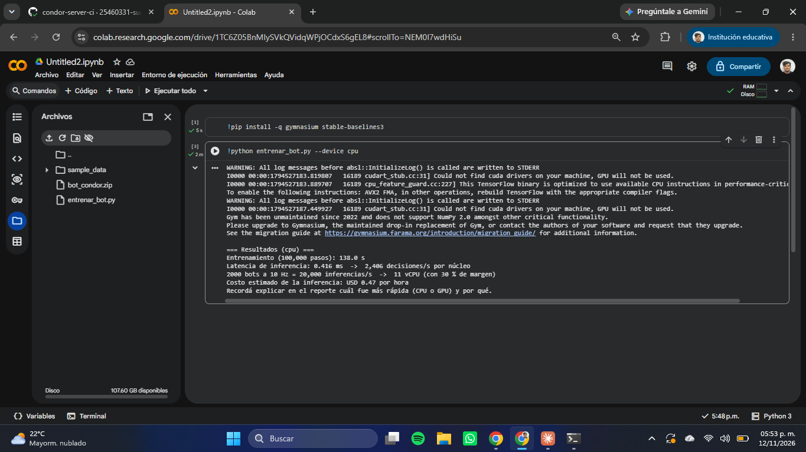<figcaption style="font-size:7.5pt">3.1 CPU en Colab</figcaption></figure>
<figure style="width:32%;margin:0">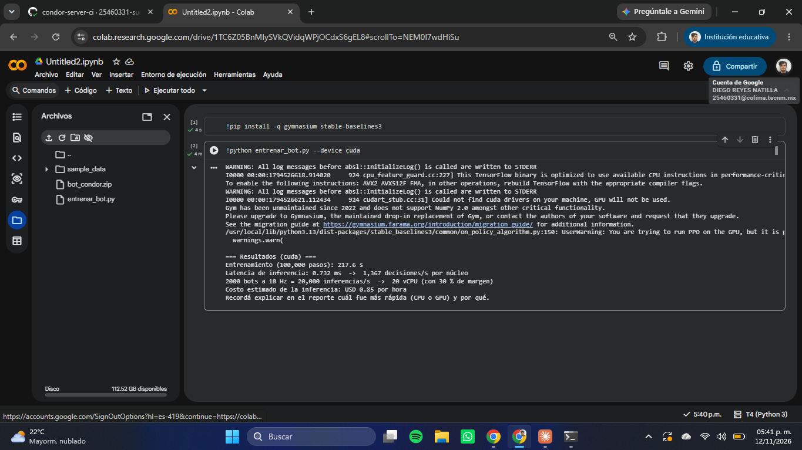<figcaption style="font-size:7.5pt">3.1 GPU T4 en Colab</figcaption></figure>
<figure style="width:32%;margin:0">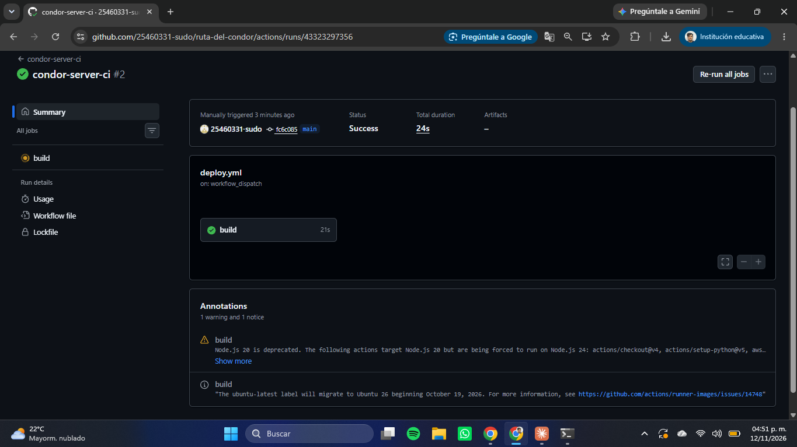<figcaption style="font-size:7.5pt">3.2 Pipeline en verde</figcaption></figure>
<figure style="width:32%;margin:0">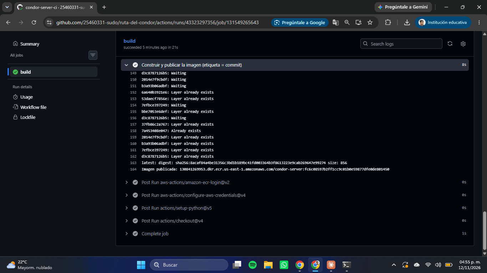<figcaption style="font-size:7.5pt">3.2 Imagen con la etiqueta del commit</figcaption></figure>
<figure style="width:32%;margin:0">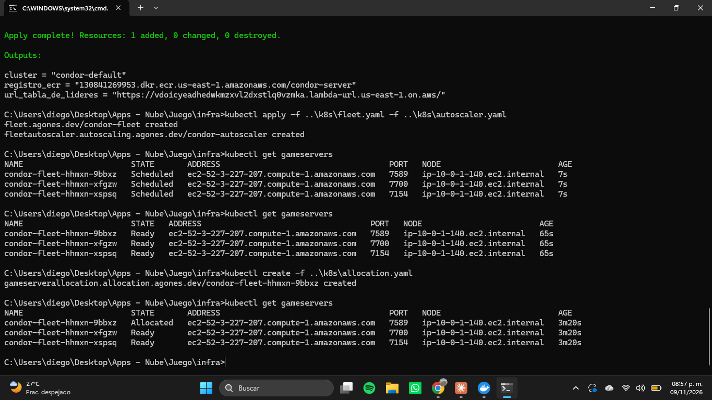<figcaption style="font-size:7.5pt">3.3 Servidores: uno pasa a Allocated</figcaption></figure>
<figure style="width:32%;margin:0">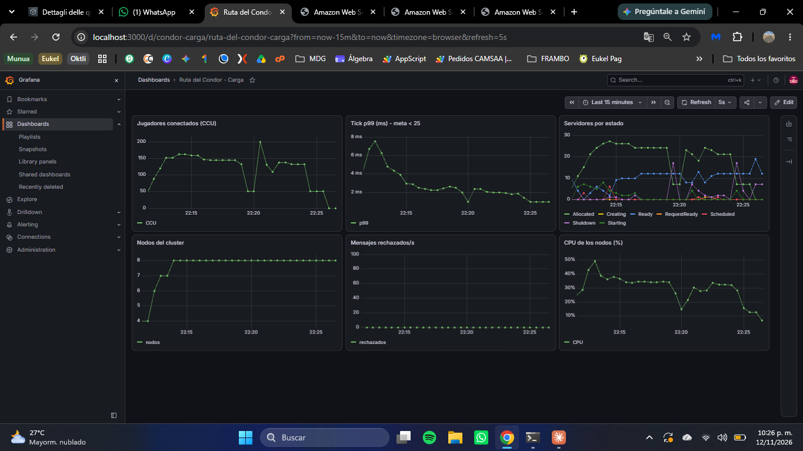<figcaption style="font-size:7.5pt">3.4 Pico de 200 jugadores</figcaption></figure>
<figure style="width:32%;margin:0">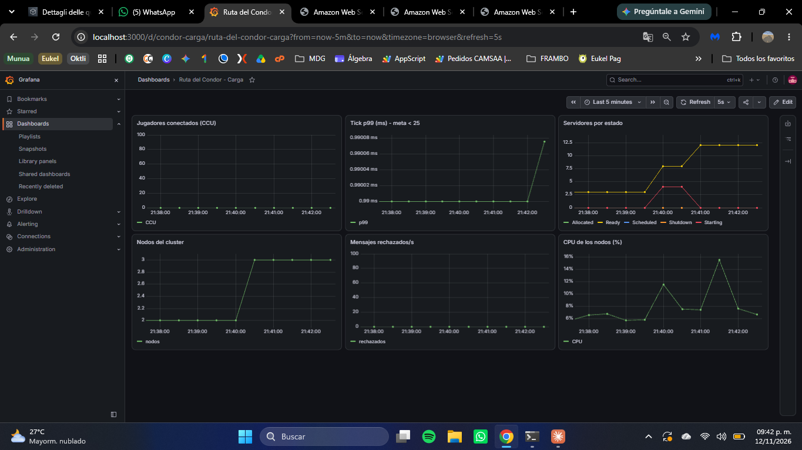<figcaption style="font-size:7.5pt">3.4 Autoescalado de nodos</figcaption></figure>
<figure style="width:32%;margin:0">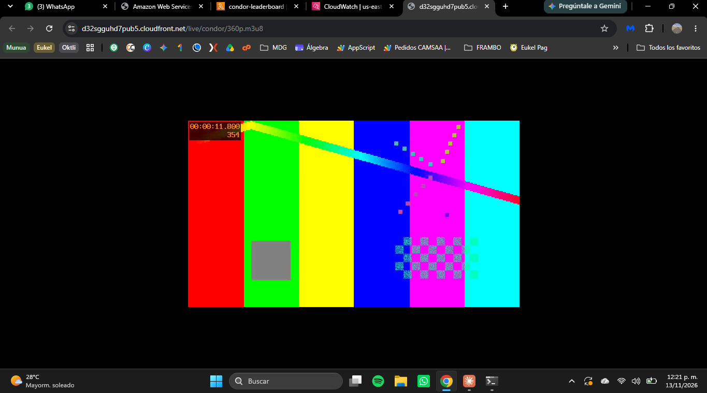<figcaption style="font-size:7.5pt">3.4 Stream por CloudFront</figcaption></figure>
<figure style="width:32%;margin:0">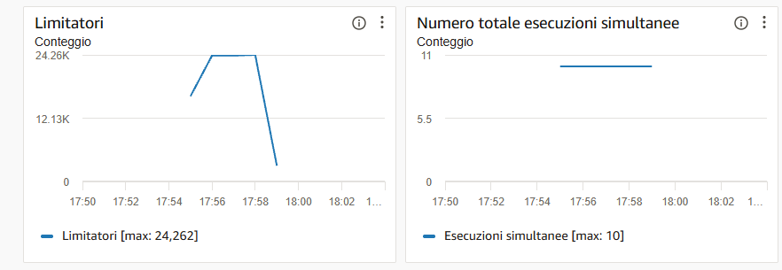<figcaption style="font-size:7.5pt">3.5 Lambda: concurrencia 10 y throttles</figcaption></figure>
<figure style="width:32%;margin:0">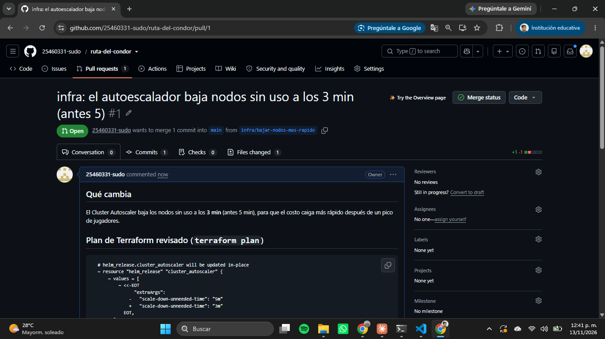<figcaption style="font-size:7.5pt">3.6 Pull request con el plan</figcaption></figure>
<figure style="width:32%;margin:0">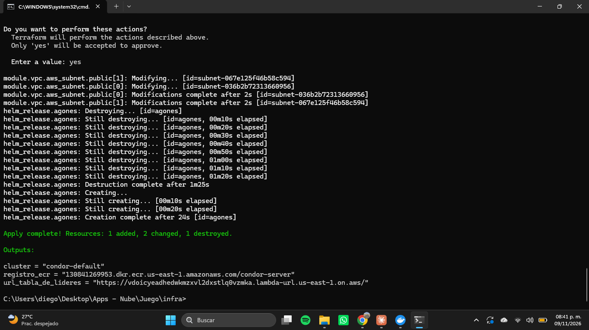<figcaption style="font-size:7.5pt">3.6 terraform apply completo</figcaption></figure>
<figure style="width:32%;margin:0">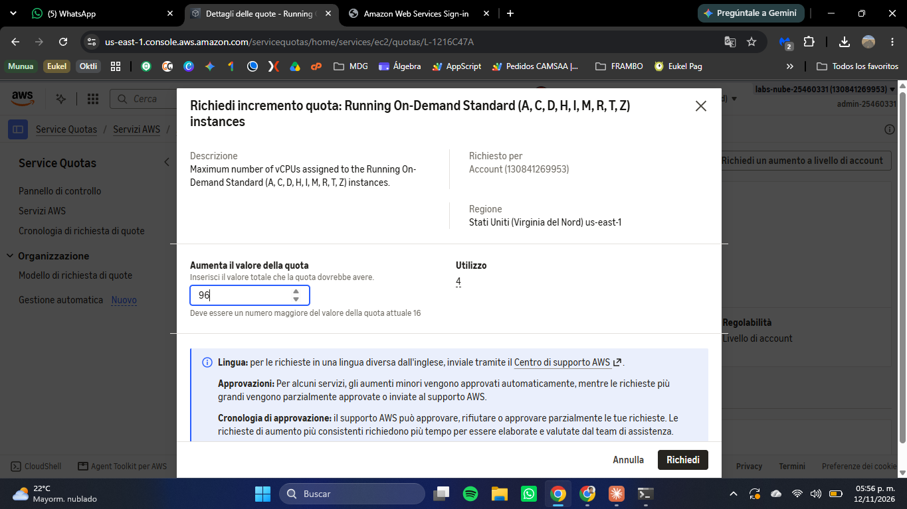<figcaption style="font-size:7.5pt">3.4 Cuota de vCPU aprobada (96)</figcaption></figure>
<figure style="width:32%;margin:0">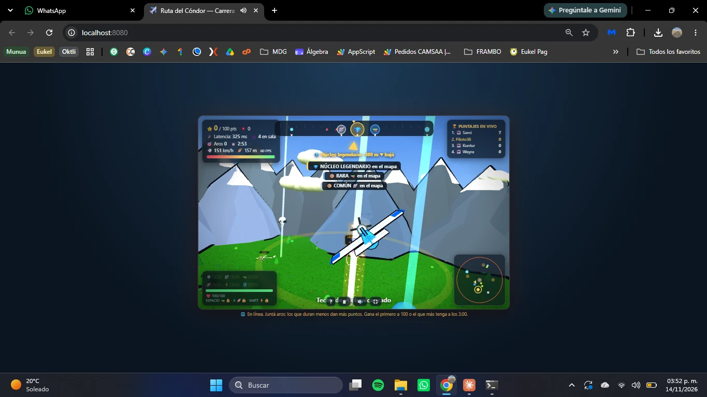<figcaption style="font-size:7.5pt">Jugando contra el servidor en EKS</figcaption></figure>
<figure style="width:32%;margin:0">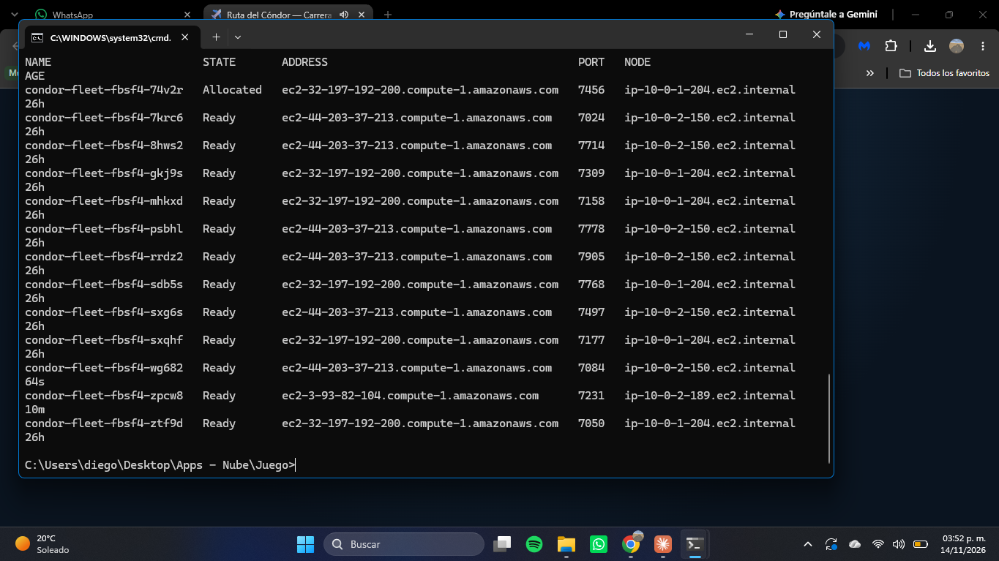<figcaption style="font-size:7.5pt">Servidor Allocated en AWS</figcaption></figure>
<figure style="width:32%;margin:0">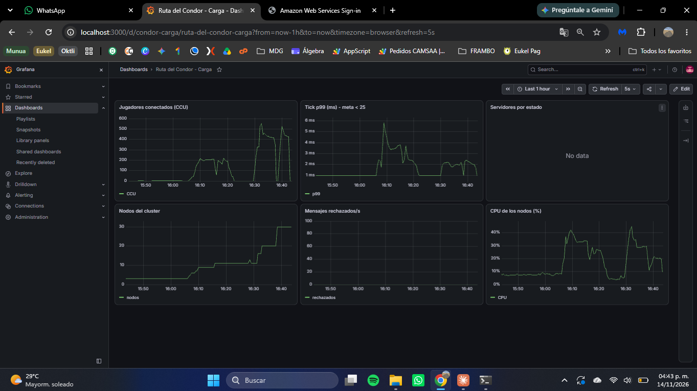<figcaption style="font-size:7.5pt">3.4 Corrida de 600 jugadores: Grafana</figcaption></figure>
<figure style="width:32%;margin:0">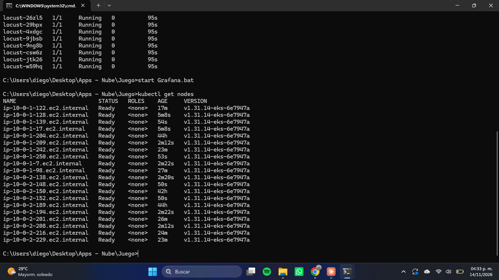<figcaption style="font-size:7.5pt">3.4 Nodos subiendo con 600 jugadores</figcaption></figure>
<figure style="width:32%;margin:0">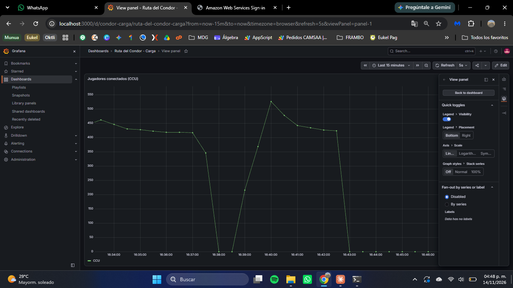<figcaption style="font-size:7.5pt">3.4 CCU: rampa, pausa y pico (~525)</figcaption></figure>
<figure style="width:32%;margin:0">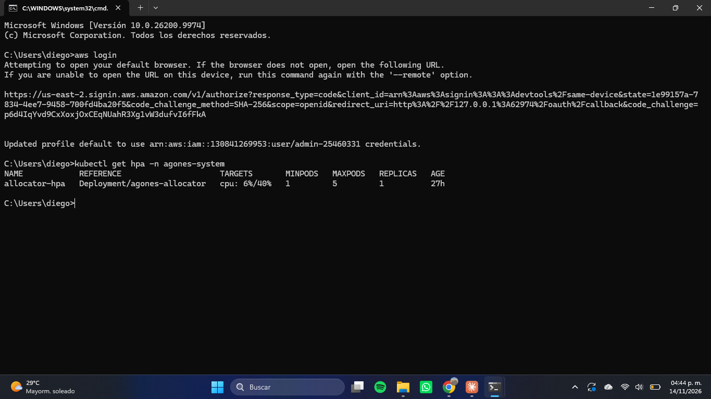<figcaption style="font-size:7.5pt">3.4 HPA midiendo CPU</figcaption></figure>
</div>
